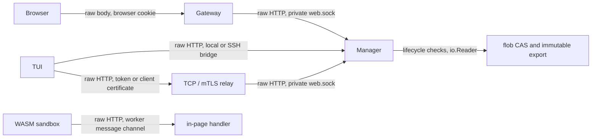

# Attachment data path

Every client uploads a raw HTTP request body to the Manager that owns the
attachment store. No protobuf content messages are created anywhere: there is
one upload path and `SessionService.Upload` no longer exists. Session discovery,
aliases and every other control operation stay on the RPC API.



`HEAD /attachments/` on the private Manager listener advertises
`Cxz-Attachment-Protocol: 1`. `POST /attachments/{runtime-id}` uses `run`, `name`
and `size` query parameters and returns `{"path":"/cxz/assets/..."}`. A relay
serves the same two on its own listener, beside the calls, and forwards them to
the Manager's socket. Metadata and actual EOF are checked independently. TUI requests use chunked HTTP so an
excess source byte cannot be silently omitted by a fixed Content-Length before
storage decides whether to publish. Browser File bodies retain their native
Content-Length. Limits and filename rules live in `internal/assets/assets.go`.

Storage consumes the same reader in both implementations. The lifecycle layer
resolves the session while holding the existing transition lock; the runtime
checks its current run, project and asset mount. The raw route reuses the
version-switch and update-maintenance stream guards for the entire operation.
The private socket keeps its existing owner-only permissions. The web gateway
retains cookie authentication, exact origin checking, body limits and logout
cancellation. No client can supply a project or destination filesystem path.
The resulting hard link is immutable and existing session purge reclaims it.

There are no upload tickets, resumable offsets, sidecar files or extra public
ports. Small legacy paste attachments sent through the separate `Attach` RPC
keep their existing semantics.

## Connection discovery and compatibility

| Connection | Data path |
| --- | --- |
| Browser through updated web gateway | Raw HTTP proxy to Manager's existing private Connect socket |
| Host-local TUI / installed Manager | Private socket, or the existing authenticated Docker exec bridge |
| Explicit conventional Unix daemon socket | Neighboring private Connect socket |
| SSH TUI | Same SSH identity, binary and state, through `_connect-http` |
| TCP relay | The relay's own listener, with the `Authorization: Bearer` its calls carry |
| mTLS relay, including enrolled SSH using mTLS | The relay's own listener, authorized by the same handshake |
| In-process WASM sandbox | The same handler, over the worker's message channel |

A relay carries bodies on the one address and with the one credential its calls
use. Both are HTTP/2, so the route is the only addition: `/attachments/` is
forwarded to the Manager's socket and everything else remains the transparent
gRPC proxy, which still passes through methods the relay does not know. There is
no second port, and no tunnel RPC -- wrapping a body in protobuf messages again
is the cost this exists to remove. The client does not infer another port,
obtain a new credential or unexpectedly open SSH after choosing an enrolled mTLS
connection; without the connection's credential there is no raw client at all,
and the connection falls back to RPC.

On the plaintext surface the token travels as the header its calls already
travel in, so there is no second credential to manage and nothing new is
exposed. On mTLS there is nothing for the route to check that the handshake has
not already refused: a request that reaches a handler presented a certificate
this installation signed, has not revoked, and issued for a client rather than
for the relay. Either way authorization happens before the body is read, so a
refused upload does not first cost the transfer.

Capability discovery happens before consuming upload bytes. A missing endpoint
or absent private socket can select compatibility; authentication failures and
timeouts are surfaced. Once POST begins, failure never retries the reader or
switches to RPC, because publication may have succeeded before the receipt was
lost. Redirects are refused. Closing the owning client cancels active transfers
and idle bridge connections. Blocking producer readers must implement io.Closer
so cancellation can interrupt their Read; successful uploads leave completed
source ownership with the caller.

Updating the UI alone does not update the Manager storage endpoint. Update both
Manager and web gateway to use the raw browser path; newer clients and gateways
cannot upload to a Manager that does not serve the route, and a relay that has
not been updated serves `/` and not `/attachments/`. Both report that rather
than falling back, because there is nothing left to fall back to. A connection
with no data path at all -- a unix address that is not a Manager's
`daemon.sock`, a relay whose credential this client does not hold -- says so
when an upload is attempted.

## Measurement

`server/lifecycle/attachments_benchmark_linux_test.go` compares the actual
resource-client gRPC adapter with its raw HTTP adapter, using the same lifecycle,
bounded repeating reader and loopback network. `discard` isolates transport
processing; `storage` adds SHA-256, temporary writes, fsync, CAS deduplication and
immutable publication. Sources are streamed rather than allocated as whole files.
Both connections are warmed before timing, including discovery and TLS handshake.
Storage repetitions use identical content after a warm upload, so they measure
the deduplication/publication case and benefit from the OS page cache.

Measured on Linux/amd64, Go 1.27.1, AMD Ryzen 7 5825U, GOMAXPROCS=2, on
2026-10-12. Each table value is the median of three runs with four operations per
run. The concurrent cases use four workers. These are short local measurements,
not production throughput guarantees. They omit browser, Docker exec and SSH
relay overhead. TLS cases include payload encryption after a trusted test
certificate handshake; production certificate management is not benchmarked.

```sh
TMPDIR=/tmp GOMAXPROCS=2 go test -p 2 ./server/lifecycle -run '^$' \
  -bench BenchmarkAttachmentDataPath -benchtime=4x -count=3 -benchmem
```

Representative storage results (throughput uses decimal MB/s):

| File | Workers | TLS | gRPC MB/s | Raw MB/s | Improvement |
| --- | ---: | --- | ---: | ---: | ---: |
| 32 KiB | 1 | No | 27.05 | 35.63 | 1.32× |
| 8 MiB | 1 | No | 363.78 | 552.03 | 1.52× |
| 64 MiB | 1 | No | 528.68 | 849.46 | 1.61× |
| 64 MiB | 4 | No | 574.97 | 1213.34 | 2.11× |
| 32 KiB | 1 | Yes | 28.62 | 34.14 | 1.19× |
| 8 MiB | 1 | Yes | 349.71 | 514.81 | 1.47× |
| 64 MiB | 1 | Yes | 454.56 | 721.25 | 1.59× |
| 64 MiB | 4 | Yes | 479.21 | 928.52 | 1.94× |

The main result is reduced byte processing and allocation, rather than wire
framing savings. For the unencrypted single-worker 64 MiB case:

| Metric | gRPC | Raw HTTP |
| --- | ---: | ---: |
| Process CPU per upload | 231.16 ms | 100.06 ms |
| Allocated bytes per upload | 131.72 MiB | 0.13 MiB |
| Allocation count per upload | 8715 | 3374 |
| GC cycles per upload | 11 | 0 |
| Sampled heap growth across run | 18.64 MiB | 0.51 MiB |

For four workers with TLS, process CPU per upload was 278.88 ms versus 145.97 ms,
allocation was 135.05 MiB versus 0.36 MiB, and sampled heap growth was 44.58 MiB
versus 1.42 MiB. CPU combines user and system time from process rusage across all
workers. Heap growth samples HeapAlloc relative to the post-GC warm baseline;
it excludes baseline memory, stacks, kernel buffers and OS page cache, and may
miss peaks between samples. It is not peak RSS or a memory limit. Raw HTTP still
copies buffers, hashes data and encrypts TLS records; it is not zero-copy.

These results are what retiring the RPC rests on. More extensive
production/relay and cold-storage measurement would still be worth having, but
the gap measured here is not close enough to argue about.

## Validation

- Raw HTTP storage tests cover binary/Unicode names, empty files, short and
  excessive streams, stale runs, cancellation, immutable publication and purge.
- Lifecycle/resource-client tests cover runtime IDs, aliases, unknown sessions,
  transaction restrictions, a Manager without the endpoint, a connection with no
  data path, and a dropped POST receipt reported rather than retried.
- The private-socket transport test verifies local installation and conventional
  Unix selection, and refuses invented TCP/mTLS endpoints.
- Web tests cover cookie/origin authentication, large raw bodies, declared sizes
  that disagree with the body, and logout during a stalled upload.
- Relay tests cover a body carried beside the calls on one listener, a foreign
  certificate refused at the handshake, and a wrong token refused before the
  body is read.
- The browser file-drop test uses the real private HTTP proxy and storage reader;
  it checks returned paths and the attachment reference sent to the conversation.
